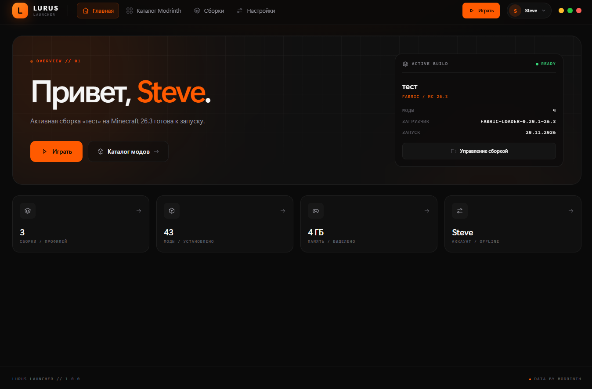

<div align="center">
  <h1>🟧 LURUS LAUNCHER</h1>
  <p><strong>Минималистичный, быстрый и современный лаунчер для Minecraft в стиле dark-tech.</strong></p>

  <p>
    <a href="https://github.com">
      
    </a>
    
    
    <a href="https://github.com">
      
    </a>
  </p>

  <p>
    <a href="https://github.com"><strong>📥 Скачать для Windows (.exe)</strong></a> •
    <a href="#-основные-возможности"><strong>✨ Возможности</strong></a> •
    <a href="#-сообщество-и-поддержка"><strong>💬 Сообщество</strong></a>
  </p>
</div>

---

## ⚡ О проекте

**Lurus Launcher** создан для игроков, которые устали от тяжёлых, перегруженных и медленных лаунчеров. Никаких лишних окон и визуального мусора — только чистый тёмный интерфейс, мгновенный доступ к сборкам и высокая скорость загрузки.

> 

---

## ✨ Основные возможности

* 🚀 **Молниеносная загрузка в 15 потоков** — ядро игры, библиотеки и моды скачиваются на максимальной скорости.
* 📦 **Полная интеграция с Modrinth** — поиск и установка модов, шейдеров, ресурспаков и готовых сборок (`.mrpack`) в один клик с красивыми карточками и переключателями Вкл/Выкл.
* ☕ **Автоматическая установка Java** — лаунчер сам определяет и скачивает нужную версию Java (17 или 21) для выбранной версии Minecraft.
* 🔐 **Поддержка любых аккаунтов** — официальная лицензия **Microsoft**, система скинов **Ely.by** и свободный **Offline-режим**.
* 🩺 **Умная диагностика крашей** — при вылете игры показывает понятный код ошибки и причину проблемы на русском языке.
* 🎮 **Изолированные сборки** — каждая сборка хранит свои моды, миры и настройки в отдельной папке, плюс поддерживается быстрый импорт/экспорт `.mrpack`.
* 🔄 **Автообновление** — лаунчер сам проверяет выход новых патчей и обновляется в один клик.

---

## 📥 Установка и запуск

1. Перейдите в раздел **[Releases](https://github.com)** и скачайте свежий файл **`Lurus-Launcher-Setup.exe`**.
2. Запустите установщик и дождитесь завершения установки.
3. Создайте свою сборку или импортируйте готовую (например, *Fabulously Optimized*), выберите никнейм/аккаунт и нажмите **«Играть»**.

---

## 💬 Сообщество и поддержка

* 📢 **Telegram-канал с новостями и обновлениями:** [Подписаться](https://t.me/lurushub)
* 💬 **Discord-сервер (общение, сборки и помощь):** [Присоединиться](https://discord.gg/qh2J6hjaqT)
* 🐞 **Нашли баг или есть идея?** Создайте обращение во вкладке **[Issues](https://github.com)**.

---

## ⚖️ Правовая информация

```text
© 2026 maynes01. All Rights Reserved.
Не является официальным продуктом Minecraft. Не одобрено и не связано с Mojang или Microsoft.
```

